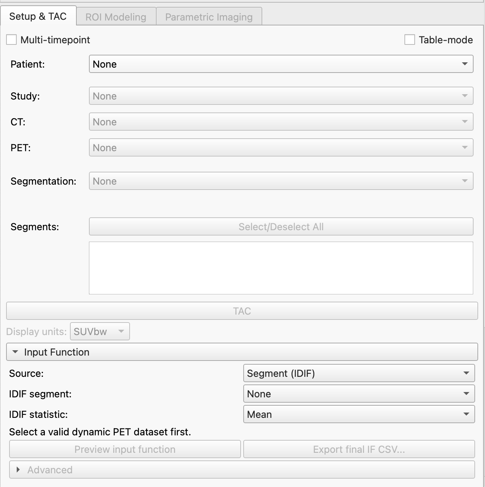

# SlicerDynamicPET

<p align="center">
  
</p>

**SlicerDynamicPET** is an open-source extension for [3D Slicer](https://www.slicer.org/) dedicated to importing, visualizing, and quantitatively analyzing **dynamic positron emission tomography (PET)** data. It brings PET DICOM import, regional time-activity curves (TACs), kinetic modeling, voxel-wise parametric imaging, and temporal RT Structure Set workflows into a common Slicer environment.

> **Status: Beta / research software.** SlicerDynamicPET is under active development. It is **not a medical device** and must be independently validated for each scanner, tracer, acquisition protocol, reconstruction, kinetic model, and intended use. Some advanced DICOM features implement specialized conventions and may require additional interoperability testing.

## Components

The extension contains a main C++ module and three separately maintained Git submodules:

| Component | Responsibility |
| --- | --- |
| **DynamicPET** | Interactive setup; ROI TAC extraction; input-function handling; ROI and voxel-wise kinetic modeling; parametric images; visualization and export. |
| [**dPETImporter**](https://github.com/DanieleDallOlio/dPETImporter) | PET DICOM import, Volume Sequences, static PET metadata, quantitative calibration, source-image provenance, and DICOM Parametric Map import. |
| [**dRTImporter**](https://github.com/DanieleDallOlio/dRTImporter) | Import of supported temporal RTSTRUCTs as segmentation sequences; static and dynamic RTSTRUCT export helpers. |
| [**KMAP-CPP**](https://github.com/DanieleDallOlio/KMAP-CPP) | Standalone C++ tracer kinetic-modeling backend derived from the open-source KMAP-C Toolkit. |

KMAP-CPP derives from the [Open KMAP-C Toolkit](https://github.com/ShareKM/KMAP-C) and retains its upstream attribution and licensing.

## Main capabilities

### PET import and quantitative metadata

- Import conventional dynamic PET organized as one 3D image per frame or as 2D slice stacks per frame.
- Import supported **Enhanced PET** multiframe acquisitions, including single-SOP temporal datasets, as Volume Sequences.
- Preserve frame/acquisition timing, image units, decay-correction information, and DICOM source-image references where available.
- Optionally convert supported PET activity concentrations to **SUVbw** when the necessary DICOM information and decay conventions are valid.
- Optionally load **static/whole-body PET** with kinetic metadata retained for subsequent analysis.
- Import supported **DICOM Parametric Map (PM)** objects as Slicer volumes.

Import support is deliberately conservative: unsupported Enhanced PET organization, inconsistent timing, incomplete DICOM provenance, or unrecognized quantitative mappings can prevent particular workflows from proceeding.

### Analysis modes

**Single-image mode** analyzes one dynamic PET Volume Sequence with its assigned segmentation(s), or an appropriate existing image-based dataset.

**Multi-timepoint mode** combines observations from two or more PET acquisitions, such as an early 4D dynamic PET scan followed by a late static acquisition. Each dynamic PET frame contributes an observation; each supported static PET acquisition contributes one. Actual acquisition intervals and gaps are retained. **No artificial PET frames or synthetic cross-acquisition volume sequence are generated.**

Multi-timepoint validation checks, among other things:

- an earliest **dynamic** acquisition and at least two selected acquisitions;
- PET studies associated with the selected patient and loaded through dPETImporter;
- compatible radiotracer administration, tracer identity, acquisition timing, decay correction, and quantitative normalization;
- an assigned segmentation for every acquisition, with at least one **exact, uniquely named common segment**;
- compatible spatial and temporal information for extracting ROI statistics.

Supported quantitative inputs include Bq/mL and SUVbw when normalization is valid. Multi-timepoint mode currently accepts `START` or `ADMIN` decay correction and rejects unsupported static acquisitions with **spatially varying bed/slice timing**, rather than inventing a single time for the entire volume. Overlapping prepared observations are rejected during TAC extraction. Refer to status messages in the acquisition-selection dialog for the exact reason a dataset fails validation.

**Table-based mode** imports existing ROI TAC observations from a supported workbook without requiring PET image voxels. It supports downstream analysis of the supplied observations; image-only functions such as voxel-distribution plots and parametric volume generation are not available from a table alone.

### Regional TACs, input functions, and models

- Extract ROI statistics from segmentations, with temporal frame timing preserved.
- Inspect TACs and selected statistical or ROI-volume measures.
- Use a segmentation-derived **image-derived input function (IDIF)**, an external input-function dataset, or a calibrated **population-based input function (PBIF)** where supported.
- Handle parent-fraction information and plasma/whole-blood input domains when required by the model.
- Perform graphical kinetic analysis (including supported Patlak, Logan, and reversible-equilibrium approaches), relative variants for suitable partial/delayed acquisitions, and compartment-model fitting.
- Export available TACs, model results, and fitted curves to Excel workbooks.

**Input-function coverage matters.** A combined TAC can extend beyond the measured input function, but fitting is limited to the time support and model assumptions actually available. Some workflows offer explicitly selected modeling/extrapolation options; these must not be confused with additional measured data. Model availability is evaluated from the chosen input and acquisition timing.

### Voxel-wise modeling and parametric imaging

- Run supported graphical and compartmental models voxel by voxel.
- Generate quantitative parameter volumes and visualize them in Slicer.
- Use supported optimized/model-selection views, including RGB summaries when available.
- Export supported quantitative parametric maps in **DICOM PM** format using PET-source provenance retained during import.

RGB model-selection displays are for visualization; they are **not** exported as quantitative DICOM Parametric Maps. Voxel-wise analysis can be computationally expensive and memory-intensive, particularly for large total-body 4D acquisitions. No fixed memory requirement is implied for all datasets.

### Segmentation and RTSTRUCT workflows

- Use an ordinary segmentation for all frames of a dynamic PET, or use a synchronized **segmentation sequence** with frame-specific ROI geometry.
- Import supported dynamic RTSTRUCTs through dRTImporter; ordinary static RTSTRUCT import is handled by **SlicerRT**.
- Export a dynamic PET segmentation sequence as a **temporal RTSTRUCT** using supported DICOM temporal-reference conventions.
- In Multi-timepoint mode, export **one RTSTRUCT per prepared acquisition**: temporal RTSTRUCTs for dynamic acquisitions and conventional RTSTRUCTs for static acquisitions.

Temporal RTSTRUCT representation is **not a standardized DICOM model for time-varying contours**. Conventional temporal-reference variants and the Enhanced PET private temporal mapping supported by dRTImporter should be tested for round-trip consistency and interoperability with intended third-party software. Static RTSTRUCT export requires access to the corresponding source DICOM instances in Slicer's DICOM database; dynamic RTSTRUCT export requires suitable frame-level PET provenance.

## Typical workflows

### Dynamic PET

1. Import a PET study into the **DICOM** module using the appropriate dPETImporter loadable.
2. Load the dynamic PET as a **Volume Sequence** and verify its frame count, timing, units, and decay correction.
3. Select a segmentation, or create/import ROIs using Slicer's segmentation tools.
4. Compute and review regional TACs.
5. Choose the input function and the applicable graphical or compartment model.
6. Perform ROI modeling and, where appropriate, voxel-wise parametric imaging.
7. Review the plots, fitted parameters, and volumes; export the relevant results.

### Dynamic acquisition plus a late static scan

1. Import both acquisitions, explicitly choosing dPETImporter's optional kinetic-metadata loadable for the static acquisition.
2. Enable **Multi-timepoint** and select both acquisitions for the same patient.
3. Assign a segmentation to each acquisition, using **identical ROI names** for the regions to be compared.
4. Check the acquisition validation message and prepare the selected acquisitions.
5. Extract the merged ROI TAC, noting the real temporal gap.
6. Supply an input function covering the required modeling interval before fitting.
7. If needed, use **Save Multi RTSTRUCTs** to export acquisition-specific segmentation files.

### Existing TAC table

1. Select the table-based workflow and load a supported workbook.
2. Verify observation timing, quantitative units, and supplied statistics/uncertainties.
3. Configure an appropriate input function and perform supported ROI modeling.
4. Export the derived tables and fitted curves.

## Installation

### Slicer Extensions Manager

SlicerDynamicPET is intended for distribution through the **3D Slicer Extensions Manager**. Until a compatible public package is available, use a development build.

### Source checkout and development build

SlicerDynamicPET includes a compiled C++ loadable module and must be built against a compatible **3D Slicer development/build environment**. The source checkout requires submodules:

```bash
git clone --recurse-submodules https://github.com/DanieleDallOlio/SlicerDynamicPET.git
cd SlicerDynamicPET
```

If the repository has already been cloned:

```bash
git submodule update --init --recursive
```

Configure with the appropriate Slicer build directory and build using the generator/toolchain compatible with your Slicer installation. For example:

```bash
cmake -S . -B build -DSlicer_DIR=/path/to/Slicer-build
cmake --build build --config Release --parallel
```

The actual `Slicer_DIR`, build generator, compiler, and extension-loading procedure depend on the local Slicer installation and platform. This project is not a standalone Python-only extension: cloning the source code does not itself install the C++ module into an existing Slicer application.

Repository layout:

```text
SlicerDynamicPET/
|-- DynamicPET/        # Main C++ Slicer module
|-- KMAP-CPP/          # Kinetic modeling backend (submodule)
|-- dPETImporter/      # PET DICOM importer (submodule)
`-- dRTImporter/       # Temporal RTSTRUCT support (submodule)
```

### Dependencies and optional acceleration

- **3D Slicer** and its DICOM, Sequences, Segmentations, plotting, and MRML infrastructure.
- **SlicerRT** for RT Structure Set/segmentation integration; declared as an extension dependency.
- **KMAP-CPP**, **dPETImporter**, and **dRTImporter** from the pinned submodules.
- **OpenMP**, optional for acceleration. The project is designed to build without OpenMP if it cannot be found.
- The DICOM PM import/export paths use Python **highdicom**; the relevant code can install it on demand when absent. Network access or an already-installed compatible environment may be needed.

## Compatibility and validation

SlicerDynamicPET has been developed and most extensively exercised with **total-body dynamic PET acquired on United Imaging systems**. DICOM handling may differ between vendors, scanner models, reconstruction packages, and software versions.

Before quantitative interpretation, independently check:

- temporal frame identification, order, start/end times, and frame durations;
- injected tracer, radionuclide half-life, and administration timestamp;
- decay-correction convention, PET units, SUV type, weight, and injected dose;
- voxel geometry, DICOM frame of reference, and segmentation alignment;
- input-function type, units, parent fraction, and support over the tissue sampling interval;
- applicability and identifiable parameters of the selected kinetic model;
- accuracy of exported DICOM objects, ideally by reimporting them.

For whole-body/static PET, individual beds or slices may have different acquisition times. Such acquisitions must not be treated as if every voxel were sampled at one global instant.

## Reporting problems and contributing

Issues, documentation improvements, validation datasets that can legally be shared, and contributions for additional DICOM organizations are welcome.

When reporting a problem, please include the Slicer and extension versions/commit, operating system, relevant importer and submodule revisions, PET scanner and reconstruction software, tracer, dynamic-frame organization, expected versus detected timing, units, decay-correction convention, reproducible steps, and anonymized logs or DICOM metadata where possible.

**Patient privacy:** Do **not** upload identifiable clinical DICOM files, personal health information, or unverified anonymized clinical data to public GitHub issues.

## Screenshots

<p align="center">
  
</p>

Additional screenshots of import, TAC analysis, kinetic fitting, parametric imaging, and temporal segmentation workflows are welcome.

## Architecture

```text
SlicerDynamicPET
|-- dPETImporter  : DICOM PET/PM import, metadata, and Volume Sequences
|-- dRTImporter  : temporal RTSTRUCT import and static/dynamic export helpers
|-- DynamicPET   : workflow UI, TACs, kinetic analysis, parametric maps
`-- KMAP-CPP     : reusable standalone C++ kinetic-modeling backend
```

## Research use, citation, and licensing

SlicerDynamicPET is research software and **is not a medical device**. Its results should not replace independently validated clinical software.

A publication specifically describing SlicerDynamicPET will be listed here when available. When using it in scientific work, please also cite **3D Slicer**, the original **KMAP/KMAP-C** work where appropriate, and the publications defining the kinetic models used.

Original SlicerDynamicPET code is distributed under the **MIT License**; see [LICENSE.txt](LICENSE.txt). Bundled/derived software retains its own license and attribution, including the KMAP-C notices in KMAP-CPP. 3D Slicer and SlicerRT retain their own software licenses.

## Author

**Daniele Dall'Olio**  
University of Bologna

- [GitHub](https://github.com/DanieleDallOlio)
- [University profile](https://www.unibo.it/sitoweb/daniele.dallolio)

## Acknowledgments

SlicerDynamicPET builds on the 3D Slicer ecosystem and the work of its MRML, DICOM, Sequences, Segmentations, plotting, and SlicerRT contributors.

Thanks to the **Nuclear Medicine team at the Sant'Orsola Hospital in Bologna** for their support, feedback, and testing, especially **Irene Brusa**.

The modeling backend derives from the Open KMAP-C Toolkit. The original KMAP-C contributors and the Open Kinetic Modeling Initiative are acknowledged for their work.
